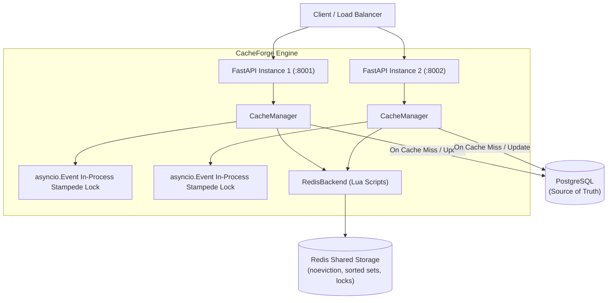

# CacheForge

**CacheForge** is a production-grade distributed caching engine built with Python 3.11+, FastAPI, Redis, and PostgreSQL. It reduces database load and API latency by serving frequently accessed items from cache using the cache-aside pattern, while enforcing strong consistency guarantees, pluggable eviction strategies, stampede protection, and memory bounds.

---

## 1. Architecture Overview



### ASCII Architecture

```
Client -> FastAPI instance(s) [api1:8001, api2:8002]
               |
          CacheManager
               |
         +-----+------------------------------------------+
         |                                                |
   (Cache Hit)                                      (Cache Miss)
         |                                                |
   RedisBackend                               In-Process asyncio.Event
   (Atomic Lua Scripts)                       + Redis Distributed Lock
         |                                                |
   Redis Storage                               PostgreSQL (AsyncPG / SA)
   - Data keys (cf:items:{id})                            |
   - Eviction ZSET (cf:__meta:lru)                Write to Cache via Lua
   - Memory Hash (cf:__mem)                       (guarded by Version Token)
   - Version Hash (cf:__ver)                              |
                                                     Return Value
```

---

## 2. Key Design Decisions

### 2.1 Pluggable Cache Backends
- **`InMemoryBackend`**: Single-process reference implementation featuring controllable clocks, background expiry sweeper, and thread-safe limit enforcement. Used for deterministic unit testing.
- **`RedisBackend`**: Distributed storage shared across all API instances. All mutations are executed atomically via Lua scripts.

### 2.2 Application-Controlled Eviction (No Redis Maxmemory)
Rather than relying on Redis's built-in `maxmemory-policy`, Redis is configured with `maxmemory-policy noeviction`. CacheForge manages its own metadata structures:
- **LRU / FIFO**: Sorted set (`ZSET`) where the score represents access or insertion timestamps (ms).
- **LFU**: Sorted set where score combines frequency and recency: `(freq << 20) | (recency_ms & 0xFFFFF)`, breaking ties on least recent access.
- **Memory accounting**: Running byte counter tracking payload size and overhead. When `max_entries` or `max_memory_bytes` limits are reached, the Lua script evicts victims atomically.

### 2.3 Stampede Protection (Cache Stampede / Dogpiling)
When high concurrency misses occur on the same key:
1. **In-process lock (`asyncio.Event`)**: Prevents hundreds of concurrent coroutines in the same process from calling the loader. Only the leader proceeds; waiters await the event.
2. **Distributed lock (`SET NX PX` with UUID token)**: Prevents duplicate loader runs across distinct API instances. The lock is released safely via a Lua compare-and-delete script.
3. **Timeout fallback**: Waiters that exceed `CACHE_STAMPEDE_TIMEOUT` fall back to a direct database query without caching to prevent request starvation.

### 2.4 Consistency Guarantees & Stale-Repopulation Prevention
- **Strategy**: Cache-aside with **Update DB -> Invalidate Cache**.
- **Stale Repopulation Race Guard**:
  - Every key has a monotonically increasing version counter stored in `cf:__ver`.
  - When invalidating, the version is incremented atomically.
  - Before reading from the database, a loader records the current key version.
  - The cache write (via Lua) only succeeds if the version has remained unchanged during the DB read. If an invalidation occurred while the DB query was in-flight, the stale value is discarded and not written to cache.
- **Known Limits**: A sub-millisecond inconsistency window exists between the PostgreSQL transaction commit and the subsequent Redis invalidation command.

### 2.5 Negative Caching
Database "not found" results (`None`) are cached with a shorter TTL (`CACHE_NEGATIVE_TTL`, default 30s) to prevent repeated database scans for nonexistent records.

### 2.6 Graceful Degradation
If Redis is down or unreachable:
- All cache operations catch connection errors without crashing the request.
- Requests automatically fall back to querying PostgreSQL directly.
- A warning is logged and the `redis_unavailable` metric is incremented.

---

## 3. Directory Layout

```
cacheforge/
  app/
    main.py                # FastAPI app factory, lifespan, timing middleware
    config.py              # Pydantic Settings from environment variables
    api/
      cache.py             # Generic cache CRUD, invalidation, and stats
      items.py             # Demo data endpoints backed by PostgreSQL
      metrics.py           # JSON performance metrics endpoint (/metrics)
      health.py            # Component health checks (/health)
    cache/
      base.py              # CacheBackend ABC, CacheEntry model
      manager.py           # CacheManager: cache-aside, stampede, versioning
      memory_backend.py    # Reference in-memory implementation
      redis_backend.py     # Distributed Redis implementation with Lua
      serializer.py        # Envelope serializer preserving types
      policies/            # LRU, LFU, FIFO strategy classes
      lua/                 # Atomic Lua scripts (set_entry, delete_entry, evict_victims)
    db/
      repository.py        # SQLAlchemy models and ItemRepository with query counter
      seed.py              # Database seeding script
    metrics/
      counters.py          # Latency percentiles reservoir & metrics counters
tests/
  unit/                    # Policies, serializer, memory backend, redis backend, api
  integration/             # Multi-instance consistency & shared cache state
  concurrency/             # High concurrency stampede, stale races, degradation
loadtest/
  locustfile.py            # Locust test scenarios (read-heavy, mixed, write-heavy)
  scenarios/               # Key generators: Zipfian (hot keys) & Uniform
  run_benchmarks.py        # Headless benchmark matrix runner
  results/                 # Saved benchmark run JSON files
RESULTS.md                 # Benchmark results comparison table
docker-compose.yml         # Multi-container deployment (api1, api2, redis, postgres, locust)
Dockerfile                 # Multi-stage non-root container image
README.md
```

---

## 4. One-Command Workflows

### 4.1 Launch with Docker Compose
Starts `api1` (:8001), `api2` (:8002), Redis (:6379), and PostgreSQL (:5432):
```bash
docker compose up -d
```

Check health:
```bash
curl http://localhost:8001/health
```

### 4.2 Seed the Database
Seed 10,000 items (configurable):
```bash
python -m cacheforge.app.db.seed --count 10000
```

### 4.3 Run the Pytest Test Suite
Runs all unit, integration, and concurrency tests with coverage:
```bash
pytest --cov=cacheforge.app.cache --cov-report=term-missing tests/
```

### 4.4 Run the Benchmark Matrix
Executes all 7 matrix scenarios headless and generates `RESULTS.md`:
```bash
python loadtest/run_benchmarks.py --requests 300
```

### 4.5 Run Interactive Locust Load Testing
```bash
locust -f loadtest/locustfile.py --host http://localhost:8001
```
Open web UI at `http://localhost:8089`.

---

## 5. API Reference

| Method | Endpoint | Description |
|---|---|---|
| `GET` | `/health` | Healthcheck for API, Redis, and PostgreSQL |
| `GET` | `/metrics` | Performance counters, latencies, and DB query stats |
| `GET` | `/cache/{key}` | Retrieve cached value |
| `PUT` | `/cache/{key}` | Store cached value with optional TTL |
| `DELETE`| `/cache/{key}` | Delete cached key |
| `POST`| `/cache/invalidate` | Invalidate by key, prefix, or flush all |
| `GET` | `/cache/stats` | Cache occupancy, memory, and eviction metrics |
| `GET` | `/items/{id}` | Read item with cache-aside retrieval |
| `PUT` | `/items/{id}` | Update item and invalidate cache |
| `DELETE`| `/items/{id}` | Delete item and invalidate cache |
| `GET` | `/items` | List items (un-cached) |
| `POST`| `/items` | Create new item |

